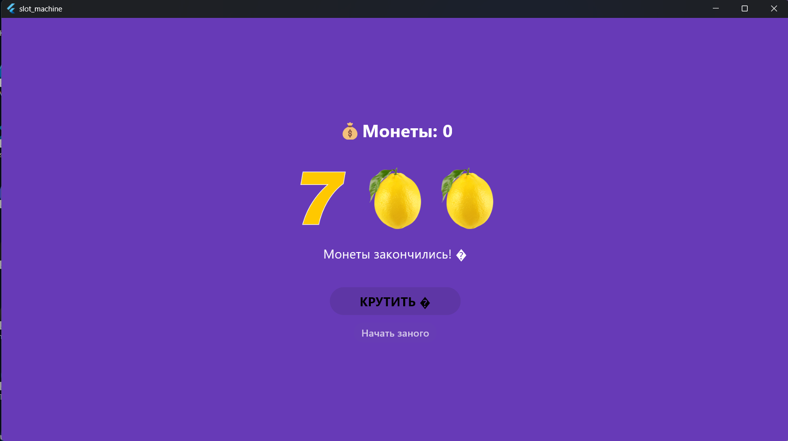

# Лабораторная работа №9. Flutter: StatefulWidget и управление состоянием

## Автор: Окишев Максим Сергеевич
## Группа: ИСП-242
## Дата: 08.11.2026

## Что изучали?

- Разницу между StatelessWidget и StatefulWidget,
- Управление состоянием приложения через setState(),
- Подключение локальных изображений и обработку нажатия кнопок — на примере слот-машины

## Скриншот финального приложения



## Инструкция по запуску

```
1. git clone <url>
2. cd slot_machinne
3. flutter run chrome
```